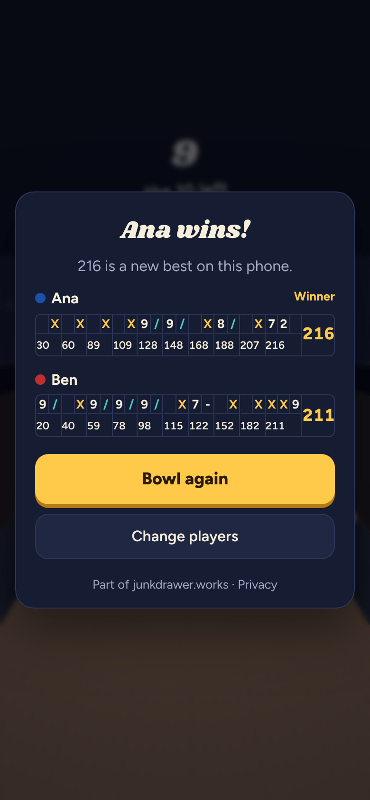

# Pin Drop

**Play it: [pin-drop.junkdrawer.works](https://pin-drop.junkdrawer.works/)**

**Ten-pin bowling with one swipe.** Swipe up to roll. Which way you swipe is where the ball goes, how fast you swipe is
how hard it's thrown, and curving the swipe puts hook on it. The ball slides through the oil and breaks on the dry end of
the lane, and the pins really knock each other over, so a ball that hooks into the pocket strikes far more often than one
thrown straight at the head pin.

<p align="center">
  
  
  
</p>

## How it plays

- **Drag the ball sideways** to choose where you stand, then **swipe up to roll**. While you swipe, a dotted line shows
  where the ball will start and an arrow shows which way it'll hook.
- **Hook is everything.** Bend your swipe and the ball keeps that side spin through the oil on the front 40 feet, then
  grips the dry back end and curves. Coming into the pocket at an angle (just right of the head pin, for a ball that
  hooks left) is how strikes happen. Straight balls leave more splits.
- **The pins are simulated, not decided.** Each one stands until something pushes it hard enough to tip it, then
  cartwheels across the deck taking out its neighbours, bounces off the side walls or drops into the pit or gutter. A
  soft hit makes a pin wobble, and it may or may not go. Real leaves turn up: the 10 pin, the 4–7, the 7–10 split.
- **Real scoring.** Ten frames, strikes and spares with their bonus balls, a tenth frame with fill balls. The card
  marks X, / and −, and calls out doubles, turkeys and splits.
- **Up to four players** pass the phone round, each with their own ball colour. Pin Drop keeps your best game and your
  last few scores, and a game you leave half-way carries on where you were.
- **Sound** is made on the spot (the rumble of the ball, the clatter of the pins, the pinsetter), with a switch in the
  menu.

## Running it

It's a static site: plain HTML, CSS and JavaScript, with no build step.

```sh
npx http-server -p 8080 -c-1 .     # then open http://localhost:8080
npm test                           # the scoring and physics in Node, then the game in Chromium (needs Playwright)
node tools/screenshots.mjs         # README screenshots and og.png (npm install first)
node tools/make-icons.mjs          # the PNG icons from icon.svg
npm run build                      # dist/artifact.html, the whole game in one file (npm install first)
```

GitHub Pages serves it from `main`, at its own address set by `CNAME`.

### Files

- `index.html`: the page, its sheets (title, menu, scorecard, end of game) and the scorecard along the top.
- `js/physics.js`: the lane, the ball and the pins, in inches seen from above: oil and hook, pin collisions as
  capsules, toppling and wobbling. Seeded, so the same throw always plays out the same way.
- `js/render.js`: draws the alley in perspective from behind the ball, with the camera following it to the pins.
- `js/scoring.js`: frames, marks, running totals, the tenth frame and splits, all worked out from the list of balls.
- `js/main.js`: turns, the swipe, the pinsetter's sweep, callouts and the sheets.
- `js/sound.js`: every sound, made with Web Audio.
- `js/store.js`: what's kept on this device, under `pin-drop.v1`.
- `css/app.css`: the look.
- `fonts/`: [Shrikhand](https://fonts.google.com/specimen/Shrikhand) and [Figtree](https://fonts.google.com/specimen/Figtree),
  both under the SIL Open Font License, served from here so nothing loads from elsewhere.
- `sw.js`: the offline copy. `manifest.webmanifest` and the icons: installing it to a home screen.
- `test/`: `scoring.test.mjs` (rules and physics) and `e2e.mjs` (a whole two-player game in Chromium, resuming,
  offline, installable).
- `tools/`: screenshots, icons and the one-file build.
