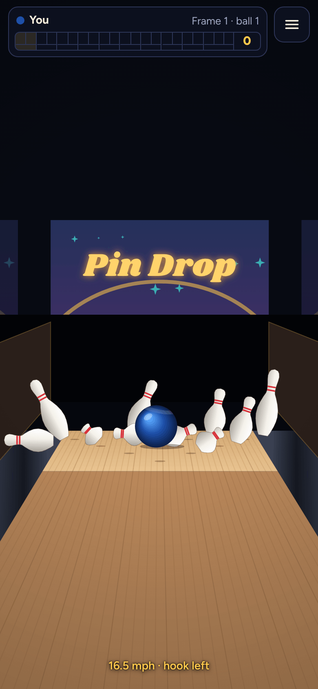

# Pin Drop

**Play it: [pin-drop.junkdrawer.works](https://pin-drop.junkdrawer.works/)**

**Ten-pin bowling with one swipe.** Swipe up to roll. Which way you swipe is where the ball goes, how fast you swipe is
how hard it's thrown, and curving the swipe puts hook on it. The ball slides through the oil and breaks on the dry end of
the lane, and the pins really knock each other over, so a ball that hooks into the pocket strikes far more often than one
thrown straight at the head pin.

<p align="center">
  
  
  
</p>

## How it plays

- **Drag the ball sideways** to choose where you stand, then **swipe up to roll**. While you swipe, a dotted line shows
  where the ball will go as far as the end of the oil, 40 feet down, and a gold arrow how it'll hook on the dry end
  from there, worked out from the real physics. The last ten feet to the pins are up to you. The dotted line lights up
  further the faster you're swiping, so you see how hard it'll go before you let go. On a trackpad, press and hold with
  one finger and flick up with another; with a mouse, hold the button down as you flick up. On a keyboard, Left and
  Right move the ball, H changes the hook (none, left, right), and holding Space winds up the throw, shown in mph with
  the dotted line, until you let go.
- **A start for new players.** On each player's first ball of a game, a ring on the lane marks a good place to stand
  and the arrow to roll over is lit gold: from there a straight ball comes into the pocket at an angle. A fingertip on
  the lane shows a new player the swipe on their very first ball, how to drag the ball over to line up the first pins
  they leave, and how to curve the end of a swipe to hook, each until they touch the lane (and drawn still with Reduce
  Motion on). A phone held on its side asks to be turned upright, where the pins show properly; a tablet plays either
  way.
- **Hook it for strikes.** Curl the end of your swipe and the ball keeps that side spin through the oil on the front 40
  feet, then grips the dry back end and curves. On a phone, only the curl at the end counts, so the arc a thumb draws of
  its own accord as it swings up throws straight, with either hand. Coming into the pocket at an angle (just right of
  the head pin, for a ball that hooks left) is how most strikes happen. Straight balls work too, and leave more splits.
  The throw is forgiving about speed: a swipe a little faster or slower than your best throws much the same ball, and
  firm flicks still differ. Firm beats flat out: thrown much harder than about 19 mph, the ball sends the pins low and
  straight back, and they leave more corner pins.
- **The pins are simulated, not decided.** Each one stands until something pushes it hard enough to tip it, then
  cartwheels across the deck taking out its neighbours, bounces off the side walls or drops into the pit or gutter. A
  soft hit makes a pin wobble, and it may or may not go. Real leaves turn up: the 10 pin, the 4–7, the 7–10 split.
  Once the ball is in, a tap on the lane hurries the pinsetter on, and after a strike or a 9, Watch again plays the
  ball again at half speed.
- **Real scoring.** Ten frames, strikes and spares with their bonus balls, a tenth frame with fill balls. The card
  marks X, / and -, rings a count that left a split, and calls out doubles, turkeys and splits, each strike in a row
  bigger than the last, with stars from a turkey on and a fanfare for a perfect game. A new best game gets a gold
  badge and a chime. While a second ball is aimed, the pins left show under the scorecard as ten dots, the way an
  alley's screen shows them.
- **The alley screen.** After a strike, a spare, a split or a gutter ball, a little old monitor drops in over the pins
  and plays a cartoon of it, the way the screens at old alleys did, with the callout across its bottom edge: pins with
  faces running for it, toppling like dominoes or one flying at the glass and sliding down it; a pin doing a double
  take for a double; a strutting, gobbling turkey for a turkey; a parade of balls in party hats over a crowd of pins
  doing the wave for four, five or more in a row (more fireworks the longer it goes); a trophy, a crowned turkey and
  confetti for a perfect game; a pin fainting, a ball with a broom, a white flag for a spare; a pin trying the splits,
  or two pins drifting apart on a cracking floor, for a split, and two tiny pins waving across a canyon for the 7–10; a
  caped ball bopping both pins of a split picked up; a ball plopping sheepishly into the gutter while the pins laugh, or
  floating off on a rubber ring; crickets for a ball that missed everything. Each has its own honks, whistles, gobbles
  and kazoos, made on the spot, and a few to choose from at random, never the same one twice running. They play while
  the pins settle and the pinsetter sweeps, so they never add to the wait; a tap skips one as it hurries the pinsetter,
  and Watch again plays the ball without it. The computer's balls get them by the same rules. With Reduce Motion on
  it's a still picture, and **Screen cartoons** in the menu switches them off on this device. Ordinary counts get none.
- **Up to four players** pass the phone round, each with their own ball. As the turn passes, the next player's
  card comes up over the lane ("Ben's turn · Tap to bowl"), and nothing can be thrown until they tap it. The Scorecard
  shows under each player's total the most they can still reach ("max 212"). On Bowl again, the second player leads
  off the next game, and from the second game the end shows tonight's tally ("Tonight: Ben 2 · Ana 1") until you
  change players. Pin Drop keeps your best game and your games, and a game you leave half-way carries on where you
  were. **Bumpers**, switched on next to a player's name, keep their ball out of the gutters: it comes off a
  rail along each side of the lane. A game with bumpers is marked in the recent games and doesn't count toward a best.
  Tapping a player's ball on the title opens their balls, where a **head start** of 10 to 50 pins evens up a game the
  way a league's handicap does: it's added to their total at the end, in a box of its own on the card (and shown on
  their ball on the title, "+20"), and a game with one doesn't count toward a best either.
- **Balls to earn.** Six plain colours are anyone's from the start, and ten more balls, each with a pattern that rolls
  with it, are earned by playing: Pearl for finishing a first game, Marble for a first strike, Two-tone for picking up
  a split, Sparkle for a turkey, Flame for 10 games, Target for making 7 of the 10 in Practise spares, Galaxy for a 200
  game, Stripe for a clean game (a strike or spare in every frame), Gold for 50 games and Prism for a perfect game. A
  game with bumpers counts for all but the 200, clean and perfect games; a head start makes no difference, and the
  computer earns none. Tapping a player's ball on the title shows them all, the locked ones with how to earn them and
  any earned since they last looked marked New; the ball they pick comes back next time they play, and shows on the
  lane, the card as the turn passes, the scorecards and their kept games. A ball earned is said under the player's
  card at the end of the game ("New ball for Ana: Marble · your first strike"), with a chime. Someone who played
  before there were balls has those their kept games show, and Forget these scores never takes one away.
- **A computer to play against** when you're on your own: "+ Add a computer player" on the title, at Rookie, Regular
  or Pro (they average about 100, 150 and 200). It bowls its own turns through the same physics, hooking its first
  ball into the pocket and throwing straight at pins left from across the lane, and misses by its level's amount. You
  watch its turn like anyone's, and a tap hurries it along. Its games are in the recent games but never count as a
  best.
- **Your games, kept.** The end card sums up each player's game under their card ("3 strikes · 2 spares · 4 open")
  and has Share, which sends "Pin Drop: Ben 131, Ana 121" and the game's link through the phone's share sheet (or
  copies it). On the title, each recent game opens its scorecard, frame by frame, and the best game opens
  **Averages**: for each player, games played, the average of their last 10, their high game, and the share of strike
  and spare chances they made (bumpers games and the computer's left out, a head start not added). Forget these
  scores, under it, clears every game and best after a second tap. The last 500 games are kept.
- **Practise spares**, under Bowl, sets up ten common leaves (the 10 pin, the 7 pin, the 3–6–10, the 2–4–5–8, the
  6–10, the 4–7, the 3–10, the 5 pin, the 2–8 and the 3–5–6–9), one ball at each, and ends with how many you made.
  It doesn't count toward anything but the Target ball.
- **Sound** is made on the spot (the thud of the ball landing, its rumble, the clatter of the pins, the pinsetter's
  whirr and clunk), with a switch in the menu that stops the buzz too, on a phone that buzzes.

## On every device, if you like: Google Drive

At pin-drop.junkdrawer.works, **Save to Google Drive** on the title keeps your games in your own Google Drive, in a
folder called "Pin Drop" with one file, `Pin Drop.json`, and merges them game by game with every phone, tablet or
computer where you turn it on, so two devices never lose a game. What goes there: every finished game (each player's
name, score and balls, which balls left splits, the ball they bowled with, and any bumpers, head start or computer
level), the best game and each player's best (with when they were bowled), the players and switches last set up on the
title and the computer's level, the ball each player picked and the balls they've earned (with when, and when they
last looked at them), how many balls each player has thrown and which lessons they've been shown, and when Forget
these scores was last tapped (which clears the scores before then on every device, including one that turns Drive on
later). What stays on each device: the sound setting, the screen cartoons switch, a game in progress, and whether that device
saves to Drive.
Spare practice isn't kept anywhere, but a Target ball it earns is.

It asks Google for `drive.file` only, so it can see nothing in your Drive but the folder and file it made. The sign-in
lasts an hour and is kept in your browser; after that the cloud in the title's corner asks for a tap. It reads your
Google account's name and email address, to show which account it saves to and to skip the account chooser next time.
**Stop saving on this device** stops it there without signing anything else out. To take the permission back
everywhere, remove junkdrawer.works under **Third-party apps & services** in your Google Account. Without Drive, or
anywhere but that address, everything stays in this browser. More at
[junkdrawer.works/privacy.html](https://junkdrawer.works/privacy.html).

## Running it

It's a static site: plain HTML, CSS and JavaScript, with no build step.

```sh
npx http-server -p 8080 -c-1 .     # then open http://localhost:8080
npm test                           # the scoring and physics in Node, then the game and its one-file copy in Chromium
                                   # (needs Playwright, and npm install first)
node tools/screenshots.mjs         # README screenshots and og.png (npm install first)
node tools/make-icons.mjs          # the PNG icons from icon.svg
npm run build                      # the whole game in one file (npm install first): dist/pin-drop.html to open
                                   # by double-clicking, and dist/artifact.html without the page around it
```

GitHub Pages serves it from `main`, at its own address set by `CNAME`.

### Files

- `index.html`: the page, its sheets (title, a player's balls, How to play, menu, scorecard, end of game) and the
  scorecard along the top.
- `js/physics.js`: the lane, the ball and the pins, in inches seen from above: oil and hook, pin collisions as
  capsules, toppling and wobbling. Seeded, so the same throw always plays out the same way.
- `js/render.js`: draws the alley in perspective from behind the ball, with the camera following it to the pins.
- `js/balls.js`: the balls to bowl with: their looks, drawn on a sphere that rolls (for the lane, the picker and the
  scorecards' dots alike), and how each is earned from a game's balls.
- `js/scoring.js`: frames, marks, running totals, the tenth frame and splits, all worked out from the list of balls.
- `js/main.js`: turns, following the finger on the lane, the pinsetter's sweep, callouts and the sheets.
- `js/swipe.js`: reading a swipe: whether a stroke slides the ball or throws it (a backswing included), and the
  throw's speed, aim and hook.
- `js/screen.js`: the alley screen: which cartoon a ball calls for, every gag drawn with code (the pins, the ball and
  the turkey with faces, fireworks, a canyon) on a little monitor with scanlines, and where the monitor goes.
- `js/sound.js`: every sound, made with Web Audio, the cartoons' honks, gobbles and kazoos too.
- `js/computer.js`: the computer player: where it stands and how it throws at each level.
- `js/store.js`: what's kept on this device, under `pin-drop.v1`, how two copies of it merge (the balls earned and
  picked too), and each player's averages.
- `js/sync.js`: saving to Google Drive, at pin-drop.junkdrawer.works only.
- `js/edge-guard.js`: a Back that comes mid-swipe (Android's back gesture, set off by a swipe near the screen's side)
  is taken for a slip, and the game stays.
- `css/app.css`: the look.
- `fonts/`: [Shrikhand](https://fonts.google.com/specimen/Shrikhand) and [Figtree](https://fonts.google.com/specimen/Figtree),
  both under the SIL Open Font License, served from here so nothing loads from elsewhere.
- `sw.js`: the offline copy. `manifest.webmanifest` and the icons: installing it to a home screen.
- `test/`: `scoring.test.mjs` (rules and physics), `swipe.test.mjs` (reading a stroke as a move or a throw, as the
  finger moves, and on a phone a thumb's arc as straight and the end of a swipe curling as a hook), `standing.test.mjs`
  (no pin left standing off the deck), `clean.test.mjs` (every ball ends clean, thrown from every corner of what a
  swipe can make: everything settled, nothing still wobbling, and the next rack just what was left), `store.test.mjs` (what's kept, with two windows open, Forget these scores and the averages), `balls.test.mjs`
  (each ball earned from a game's balls, bumpers and the computer, balls earned before there were balls to earn,
  Forget these scores keeping them, merging the balls earned and picked, a kept game's colour by number, and every
  ball drawing),
  `computer.test.mjs` (the computer's levels' averages, its pocket ball and its spares), `screen.test.mjs` (the
  cartoon each ball calls for, from a strike to a perfect game, spares, splits, the 7–10, a split picked up, a gutter
  ball, a miss and nothing for ordinary counts; no gag twice running; where the monitor fits; and every gag drawing
  every moment), `build.mjs` (the one-file
  copy, built and played from file://), `records.mjs` (the end card's counts, a kept game's scorecard, the averages
  and Forget these scores, Share, and spare practice), `drive.mjs` (Google Drive against `fake-google.mjs`, a stand-in
  for Google from the junkdrawer kit: turning it on, a second device joining, both finishing games, Forget these
  scores reaching the other device, a ball earned and picked on one device reaching the other, a refused sign-in,
  stopping, and two devices making the file at once) and
  `e2e.mjs` (a whole two-player game in Chromium, three players, strikes in a four-player tenth frame and a spare in a
  one-player one, carrying on after a reload at any moment, every sound finishing, two windows open at once, the first
  ball's marks and the lessons for a new player, bowling from the keyboard, the note on a phone on its side, a thumb's arc
  throwing straight on a phone, bumpers,
  a player's balls (picking one, a locked one, New, the pick kept and rolled down the lane, from the keyboard and on a
  phone), a ball earned said at the end of a game and of spare practice, a head start, the card as the turn passes, the most each player can still reach, Bowl again's change of who leads
  off and tonight's tally, the computer player's turns, carrying on and records, Sound off stopping the buzz, the thud
  and the pinsetter's clunks, a tap hurrying the pinsetter, the pins left under the scorecard, strikes in a row
  building up to a perfect game and a new best, Watch again, the alley screen (a strike's cartoon between the scorecard
  and the pins with the callout across its edge, a tap ending it, a gutter ball's inside the usual wait, none on Watch
  again, the menu's switch kept after a reload, a still with Reduce Motion, and every gag drawing), the ring for a split, the camera cutting with Reduce
  Motion, offline, installable). `aim.mjs` aims the tests' balls: the angle that sends a ball through a spot at the
  head pin, and the pocket ball, 2.5 in right of the head pin's middle, that strikes about two times in three.
- `tools/`: screenshots, icons and the one-file build.
