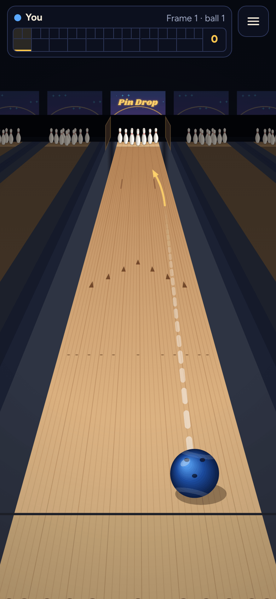

# Pin Drop

**Play it: [pin-drop.junkdrawer.works](https://pin-drop.junkdrawer.works/)**

**Ten-pin bowling with one swipe.** Swipe up to roll. Which way you swipe is where the ball goes, how fast you swipe is
how hard it's thrown, and curving the swipe puts hook on it. The ball slides through the oil and breaks on the dry end of
the lane, and the pins really knock each other over, so a ball that hooks into the pocket strikes far more often than one
thrown straight at the head pin.

<p align="center">
  
  
  
</p>

## How it plays

- **Drag the ball sideways** to choose where you stand, then **swipe up to roll**. While you swipe, a dotted line shows
  where the ball will go as far as the end of the oil, 40 feet down, and a gold arrow how it'll hook on the dry end
  from there, worked out from the real physics. The last ten feet to the pins are up to you. The dotted line lights up
  further the faster you're swiping, so you see how hard it'll go before you let go. On a trackpad, press and hold with
  one finger and flick up with another; with a mouse, hold the button down as you flick up. On a keyboard, Left and
  Right move the ball, H changes the hook (none, left, right), and holding Space winds up the throw, shown in mph with
  the dotted line, until you let go.
- **A start for new players.** On each player's first ball of a game, a ring on the lane marks a good place to stand
  and the arrow to roll over is lit gold: from there a straight ball comes into the pocket at an angle. A fingertip on
  the lane shows a new player the swipe on their very first ball, how to drag the ball over to line up the first pins
  they leave, and how to curve the end of a swipe to hook, each until they touch the lane (and drawn still with Reduce
  Motion on). A phone held on its side asks to be turned upright, where the pins show properly; a tablet plays either
  way.
- **Hook it for strikes.** Bend your swipe and the ball keeps that side spin through the oil on the front 40 feet, then
  grips the dry back end and curves. Coming into the pocket at an angle (just right of the head pin, for a ball that
  hooks left) is how most strikes happen. Straight balls work too, and leave more splits. The throw is forgiving about
  speed: a swipe a little faster or slower than your best throws much the same ball, and firm flicks still differ.
  Firm beats flat out: thrown much harder than about 19 mph, the ball sends the pins low and straight back, and they
  leave more corner pins.
- **The pins are simulated, not decided.** Each one stands until something pushes it hard enough to tip it, then
  cartwheels across the deck taking out its neighbours, bounces off the side walls or drops into the pit or gutter. A
  soft hit makes a pin wobble, and it may or may not go. Real leaves turn up: the 10 pin, the 4–7, the 7–10 split.
- **Real scoring.** Ten frames, strikes and spares with their bonus balls, a tenth frame with fill balls. The card
  marks X, / and -, and calls out doubles, turkeys and splits.
- **Up to four players** pass the phone round, each with their own ball colour. Pin Drop keeps your best game and your
  last few scores, and a game you leave half-way carries on where you were.
- **Sound** is made on the spot (the rumble of the ball, the clatter of the pins, the pinsetter), with a switch in the
  menu.

## Running it

It's a static site: plain HTML, CSS and JavaScript, with no build step.

```sh
npx http-server -p 8080 -c-1 .     # then open http://localhost:8080
npm test                           # the scoring and physics in Node, then the game and its one-file copy in Chromium
                                   # (needs Playwright, and npm install first)
node tools/screenshots.mjs         # README screenshots and og.png (npm install first)
node tools/make-icons.mjs          # the PNG icons from icon.svg
npm run build                      # the whole game in one file (npm install first): dist/pin-drop.html to open
                                   # by double-clicking, and dist/artifact.html without the page around it
```

GitHub Pages serves it from `main`, at its own address set by `CNAME`.

### Files

- `index.html`: the page, its sheets (title, How to play, menu, scorecard, end of game) and the scorecard along the top.
- `js/physics.js`: the lane, the ball and the pins, in inches seen from above: oil and hook, pin collisions as
  capsules, toppling and wobbling. Seeded, so the same throw always plays out the same way.
- `js/render.js`: draws the alley in perspective from behind the ball, with the camera following it to the pins.
- `js/scoring.js`: frames, marks, running totals, the tenth frame and splits, all worked out from the list of balls.
- `js/main.js`: turns, following the finger on the lane, the pinsetter's sweep, callouts and the sheets.
- `js/swipe.js`: reading a swipe: whether a stroke slides the ball or throws it (a backswing included), and the
  throw's speed, aim and hook.
- `js/sound.js`: every sound, made with Web Audio.
- `js/store.js`: what's kept on this device, under `pin-drop.v1`.
- `css/app.css`: the look.
- `fonts/`: [Shrikhand](https://fonts.google.com/specimen/Shrikhand) and [Figtree](https://fonts.google.com/specimen/Figtree),
  both under the SIL Open Font License, served from here so nothing loads from elsewhere.
- `sw.js`: the offline copy. `manifest.webmanifest` and the icons: installing it to a home screen.
- `test/`: `scoring.test.mjs` (rules and physics), `swipe.test.mjs` (reading a stroke as a move or a throw, as the
  finger moves), `standing.test.mjs` (no pin left standing off the deck), `clean.test.mjs` (every ball ends clean,
  thrown from every corner of what a swipe can make: everything settled, nothing still wobbling, and the next rack
  just what was left), `store.test.mjs` (what's kept, with two windows open), `build.mjs` (the one-file copy, built
  and played from file://) and `e2e.mjs` (a whole two-player game in Chromium, three players, strikes in a
  four-player tenth frame and a spare in a one-player one, carrying on after a reload at any moment, every sound
  finishing, two windows open at once, offline, installable). `aim.mjs` aims the tests' balls: the angle that sends a
  ball through a spot at the head pin, and the pocket ball, 2.5 in right of the head pin's middle, that strikes about
  two times in three.
- `tools/`: screenshots, icons and the one-file build.
